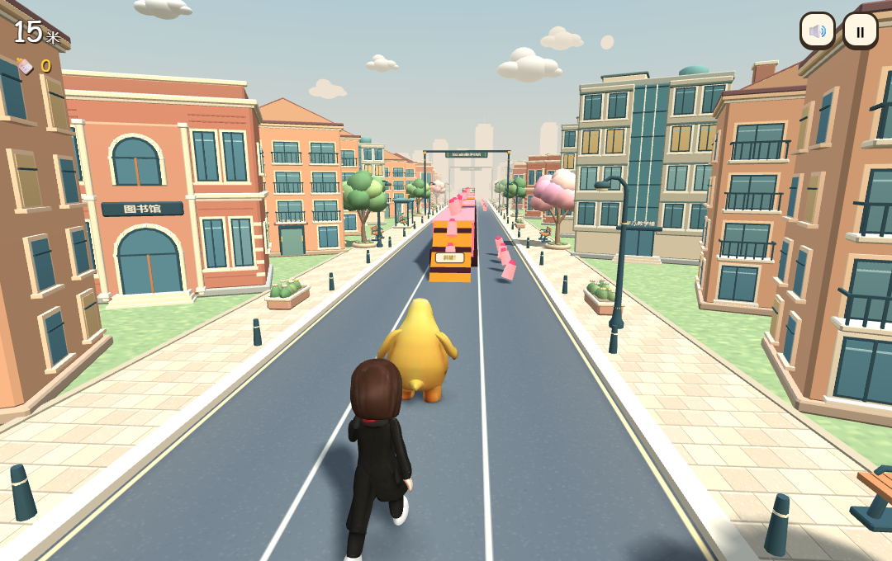
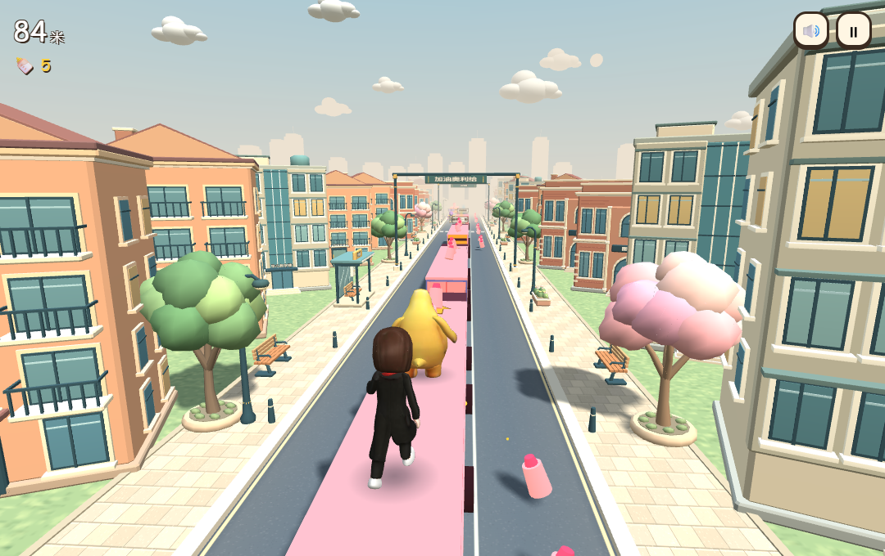

# 奶娃快跑 · 热梗跑酷

在大学城、奶昔商业街和躺平公园一路跑酷。可以跟着奶瓶走地面，也可以沿斜坡上货车、踩着车顶箭头连跳。

**在线试玩**　[Qoder Sites](https://naiwa-run-z5gt91cnxll.qoder.zone/) · [GitHub Pages](https://chhhhhhhhhhhhhhh.github.io/naiwa-run/)

电脑和手机都可以直接在浏览器开跑。[v1.1.0 更新说明](https://github.com/Chhhhhhhhhhhhhhh/naiwa-run/releases/tag/v1.1.0)

## 截图

| 开始页 | 跑酷画面 |
| --- | --- |
|  |  |

| 跑上货车车顶 | 失败页 |
| --- | --- |
|  |  |

### 手机竖屏


## 玩法

| 操作 | 键盘 | 手机 |
| --- | --- | --- |
| 闪身步（变道） | `←` `→` / `A` `D` | 左右滑动 |
| 跳跃（空中翻转） | `↑` / `空格` / `W` | 上滑 |
| 奶蛋出击（滑铲） | `↓` / `S` | 下滑 |

- 躲开低头族手机、EMO 立牌、灭霸、早八闹钟、油饼、杠精和货车。看到黄黑底座上的「跳过闹钟」标记时，可以跳过去或换道。
- 开局第 26 米有三辆车组成的连跳路线。沿斜坡上车，在车顶箭头处起跳。后续有 7 种车队组合，包括同车道直跳、换道连跳和错位并排。奶瓶沿斜坡和车顶排列，地面也有奶瓶引导绕行。
- 相信光盾、奥利给冲刺、磁吸奶瓶和篮球都用半透明光柱和地面光圈标记。护盾和冲刺能把撞到的障碍旋转撞飞，弹出「肘开！」，最后在空中留下十字闪光。冲刺期间可以连续撞飞障碍，护盾每次抵挡消耗一层。
- 拾取篮球彩蛋「鸡你太美」可获得 5 枚奶币。
- 速度从 13 m/s 起步，400 米后加速稍快，最高 40 m/s，镜头 FOV 会跟着拉大。
- 撞了就随机来一句梗，豆包老师会沿着奶娃跑过的车道追来。右上角可以暂停或静音。

## 特性

- 奶娃与豆包老师使用 GLB 骨骼模型，支持待机、跑步与角色专属动作。
- 两位角色随街景的日光和天光变化，脚下的接触阴影贴合路面、斜坡和车顶。
- three.js 沿赛道布置 Blender 街景。三段景观分别以图书馆和教学楼、商铺和奶昔摊、廊亭和喷泉为地标。
- 重复的建筑和街道组件共享网格，远景使用减面版本。道路分道线采用细米白实线。
- 普通和加长货车都支持车顶落脚。带斜坡的货车可以一路跑到 2.3 米高的车顶，整辆车驶出镜头后才会回收。
- 磁吸奶瓶让附近的奶币划弧越过货车，飞向奶娃。
- 菜单先显示，角色和街景异步加载。手机端会调整竖屏镜头和渲染分辨率。
- 项目为纯静态站点，运行需要 WebGL，音效由 WebAudio 实时合成。

## 本地运行

在项目根目录运行任意一种静态服务器，再打开终端显示的地址。下方 Python 命令使用 [http://localhost:8080](http://localhost:8080)。

```bash
npx serve .
# 或者
python -m http.server 8080
```

## 角色模型

- `assets/naiwa-runner.glb` 含待机、跑步、跳跃和滑铲动作。
- `assets/doubao-teacher.glb` 含待机和追跑动作。

角色网格以三视图为参考，在 Blender 中绑定骨骼。原图的颜色、五官和衣服细节存于贴图，游戏运行时使用与街景一致的光照。

用下列命令和两张角色三视图生成带骨骼、动作和参考图的 Blender 源文件。第三个参数是源文件保存目录，GLB 输出到本项目的 `assets/`。

```bash
blender --background --factory-startup --python tools/build_blender_characters.py -- "/path/to/naiwa.jpg" "/path/to/doubao.jpg" "../naiwa-run-art"
```

## 灭霸和街景资产

使用 Blender 编辑生成的 `thanos-obstacle.blend` 和 `street-kit.blend`。下面的命令同时生成游戏使用的 GLB，输出到 `assets/`。

```bash
blender --background --factory-startup --python tools/build_thanos.py -- "../naiwa-run-art" --turnaround "../naiwa-run-art/thanos-turnaround.png"
blender --background --factory-startup --python tools/build_street_kit.py -- "../naiwa-run-art"
```

灭霸采用适合游戏视角的 Q 版比例，造型参考电影概念设计和 Hot Toys 收藏模型。 [电影概念设计](https://jsmarantz.artstation.com/projects/OyAnlw?album_id=6196360) · [Hot Toys 造型图](https://www.sideshow.com/collectibles/marvel-thanos-hot-toys-904600)

## 技术栈

- three.js（`vendor/three.min.js`）
- 原生 HTML / CSS / JavaScript
- WebAudio 实时合成音效 + SpeechSynthesis 语音
- 字体使用 ZCOOL KuaiLe，加载失败时回退到系统字体。

## 目录结构

```
index.html      页面与 HUD
boot.js         菜单首屏与游戏启动
game.js         游戏主循环、玩法、碰撞、道具、UI 文案
models.js       程序化模型、道具标记和 Blender 街景组件
assets/         角色、灭霸障碍和街景的 GLB
tools/          Blender 建模、动作和 GLB 导出脚本
audio.js        WebAudio 合成音效与语音
style.css       页面与遮罩层样式
vendor/         three.js
screenshots/    README 截图
```

## 说明

- 梗文案仅作幽默表达。
